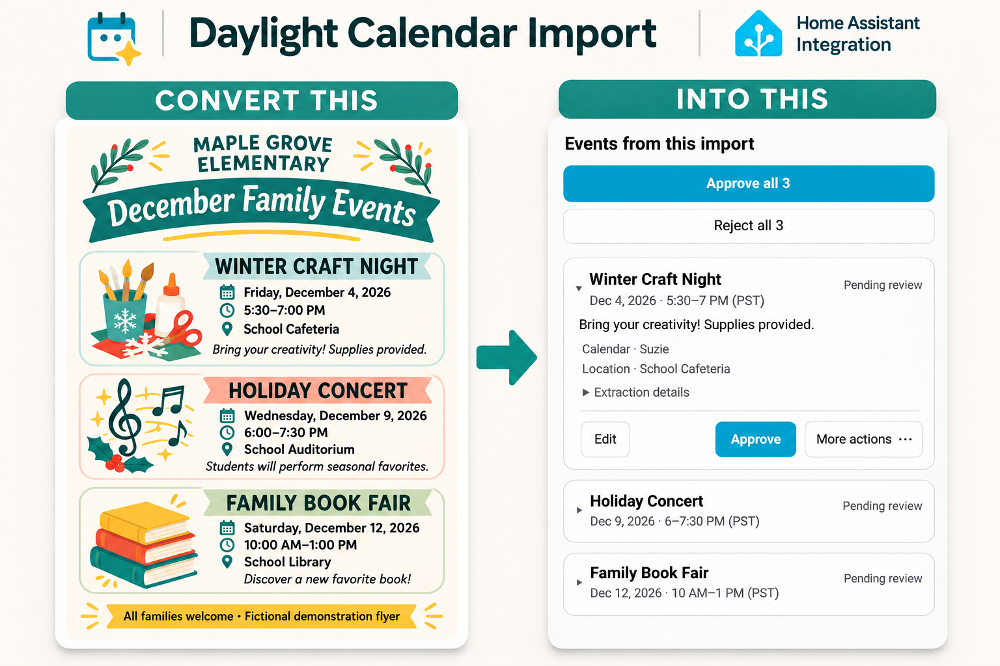

[](https://github.com/superdingo101/daylight-calendar-import#install-with-hacs)
[](https://github.com/superdingo101/daylight-calendar-import/releases)
[](https://github.com/superdingo101/daylight-calendar-import/stargazers)

[](https://github.com/superdingo101/daylight-calendar-import/issues)
[](LICENSE)

# Daylight Calendar Import for Home Assistant

Turn school newsletters, event emails, flyers, screenshots, and PDFs into Home Assistant calendar events **without entering everything by hand**.

Daylight uses your existing **Home Assistant AI Task provider** to extract event details. You review and edit each draft before it goes onto your calendar.

**Runs in your own Home Assistant instance.** Your chosen AI provider may have its own charges and privacy policies.



---

## ✨ Features

- 📧 **Email imports:** Collect announcements and attachments from a dedicated IMAP mailbox.
- 📄 **Text, images, and PDFs:** Paste a message or upload a flyer, screenshot, or document.
- ✨ **Multiple events at once:** Extract several events from a single announcement.
- ✅ **Review before adding:** Edit, approve, or reject drafts individually or in groups.
- 📅 **Multi-calendar support:** Choose default and per-event destinations, with friendly calendar aliases.
- 🔎 **Duplicate and conflict checks:** Review possible duplicates and scheduling overlaps before approval.
- 🕘 **Recent activity:** See completed imports, errors, and recovery information.
- 🔔 **Optional notifications:** Send updates through a Home Assistant notify entity.
- 🏠 **Automation sensors:** Monitor pending imports and events from Home Assistant.

<p align="center">
  <a href="https://import.daylightcalendar.com">
    
  </a>
</p>

---

## 🪄 How it works

1. **Import an announcement.** Paste text, upload an image or PDF, or enable optional email intake.
2. **Let AI find the events.** Daylight extracts dates, times, titles, locations, and other details into drafts.
3. **Review the results.** Correct details, choose a calendar, and examine possible conflicts.
4. **Approve what you want.** Only approved events are added to your Home Assistant calendars.

**Nothing from the normal import or email workflow is added to a calendar automatically.** You stay in control.

---

## 🔧 Requirements

- **Home Assistant 2026.7.4 or newer**
- At least one writable calendar entity
- A configured [Home Assistant AI Task](https://www.home-assistant.io/integrations/ai_task) entity (not just a conversation agent)
- An AI Task provider that accepts attachments if you want to import images or scanned PDFs
- HACS on older Home Assistant versions, or the built-in Marketplace on Home Assistant 2026.11+

A dedicated IMAP mailbox is **optional**. You can get started with a pasted announcement.

---

## 🚀 Installation

### Home Assistant 2026.11+: Marketplace

1. Open **Settings → Marketplace**.
2. Add `https://github.com/superdingo101/daylight-calendar-import` as a custom **Integration** repository using **Add from link**.
3. Select **Daylight Calendar Import** and install the latest stable release.
4. Go to **Settings → Devices & services → Add integration** if setup does not open automatically.
5. Choose your AI Task entity, default calendar, and allowed writable calendars.

### Install with HACS

For Home Assistant 2026.7 through 2026.10, use HACS:

[](https://my.home-assistant.io/redirect/hacs_repository/?owner=superdingo101&repository=daylight-calendar-import&category=integration)

1. Open the [HACS repository shortcut](https://my.home-assistant.io/redirect/hacs_repository/?owner=superdingo101&repository=daylight-calendar-import&category=integration), or add the [GitHub repository](https://github.com/superdingo101/daylight-calendar-import) under **HACS → Custom repositories → Integration**.
2. Install **Daylight Calendar Import** and restart Home Assistant.
3. Go to **Settings → Devices & services → Add integration** and configure your AI Task entity and calendars.

The integration is not yet in the default catalog, so the custom repository step is currently required.

<details>
<summary>Manual installation (advanced)</summary>

Download `daylight-calendar-import.zip` from a [published release](https://github.com/superdingo101/daylight-calendar-import/releases). Extract its contents into `<config>/custom_components/daylight_calendar_import/` so `manifest.json` and `__init__.py` are directly inside that folder. Restart Home Assistant, then add the integration under **Settings → Devices & services**. Preserve your existing integration and storage when upgrading.

</details>

For complete version-specific instructions, see the [installation guide](https://import.daylightcalendar.com/installation).

---

## ⚡ Quick start

Try a text import first. No email setup is needed.

1. Open **Daylight Imports** in the Home Assistant sidebar.
2. Select **New import → Paste event details**.
3. Paste an announcement such as:

   ```text
   Neighborhood board meeting
   Thursday, November 19, 2026
   6:00 PM to 7:00 PM
   Community center, Room 2
   ```

4. Select **Import events**. Daylight saves suggested events for review, not directly to a calendar.
5. Check the date, time, location, and calendar in **Review inbox**, then select **Approve** or **Reject**.

To use an image or PDF, choose **New import → Upload image or PDF** instead. You can also enable Direct IMAP later to collect event emails automatically.

> [!IMPORTANT]
> AI can misread dates, time zones, and other details. Check each draft before approval. If a calendar write reports an uncertain outcome, check the destination calendar before retrying.

---

## 📚 Documentation

Full guides are available at **https://import.daylightcalendar.com**.

### Popular guides

- [Installation](https://import.daylightcalendar.com/installation)
- [Import your first event](https://import.daylightcalendar.com/quickstart)
- [Manual text, image, and PDF imports](https://import.daylightcalendar.com/workflows/manual-import)
- [Review and approve events](https://import.daylightcalendar.com/workflows/review)
- [AI Task setup](https://import.daylightcalendar.com/configuration/ai-task)
- [Calendars and routing](https://import.daylightcalendar.com/configuration/calendars-routing)
- [Email import](https://import.daylightcalendar.com/configuration/email)
- [Troubleshooting](https://import.daylightcalendar.com/help/troubleshooting)
- [What's new in v0.9.0](https://import.daylightcalendar.com/releases/v0.9.0)

<p align="center">
  <a href="https://import.daylightcalendar.com">
    
  </a>
</p>

---

## ❓ Frequently asked questions

**Do I need Daylight Calendar Card?**  
No. [Daylight Calendar Card](https://github.com/superdingo101/daylight-calendar-card) is a separate dashboard card. Calendar Import works with your existing Home Assistant calendar integrations, with or without the card.

**Does it send my content to an AI provider?**  
It uses the Home Assistant AI Task entity you configure. Depending on your provider, source text and attachments may leave your Home Assistant instance. Review that provider's privacy and billing terms.

**Are imported events added automatically?**  
No. Normal manual and email imports create drafts for approval. An advanced immediate-import action exists for automations and bypasses that review process.

**Can I use my regular email inbox?**  
A dedicated mailbox or folder is strongly recommended. Direct IMAP can read all unread, undeleted messages in the selected mailbox, including existing unread mail. See [email setup and privacy](https://import.daylightcalendar.com/configuration/email).

---

## 💬 Community & support

Found a bug or have a feature idea? [Open a GitHub issue](https://github.com/superdingo101/daylight-calendar-import/issues). For setup problems, start with the [troubleshooting guide](https://import.daylightcalendar.com/help/troubleshooting).

<p align="center">
  <a href="https://github.com/superdingo101/daylight-calendar-import/issues">
    
  </a>
</p>

---

## 💪 Support this project

If you'd like to support development, GitHub Sponsors is the preferred option ❤️

<p align="center">
  <a href="https://github.com/sponsors/superdingo101">
    
  </a>
  <a href="https://buymeacoffee.com/superdingo101">
    
  </a>
</p>

---

## 🛠 Development status

[](https://github.com/superdingo101/daylight-calendar-import/actions/workflows/tests.yml)
[](https://github.com/superdingo101/daylight-calendar-import/actions/workflows/hacs.yaml)
[](https://github.com/superdingo101/daylight-calendar-import/actions/workflows/mutation-clean.yml?query=event%3Aschedule)

---

## ❤️ License

Daylight Calendar Import is open-source software under the [MIT License](LICENSE).
